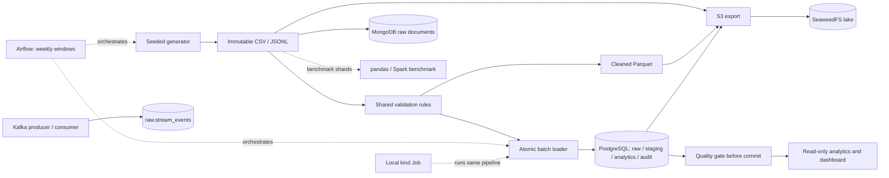
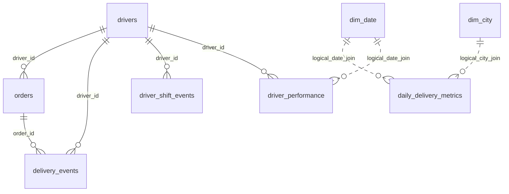

# DeliveryPulse

A local logistics data platform with PostgreSQL analytics, a transactional data-quality gate,
and replay-safe batch loading. All data is synthetic.

[](https://github.com/Aashritha-2005/DeliveryPulse-Last-Mile-Logistics-Data-Platform/actions/workflows/tests.yml)
[](https://github.com/Aashritha-2005/DeliveryPulse-Last-Mile-Logistics-Data-Platform/actions/workflows/security.yml)
[](#testing-ci-and-security)
[](LICENSE)


The screenshot shows the confirmed 50,000-order dataset: 49,450 accepted orders over
September 10–30, 2026. No demo recording has been made; a 60–90 s terminal/dashboard recording
is an optional pre-publishing step. The screenshot is the presentation artifact in use.

## Results at a glance

Historical runs on a MacBook Pro, Apple Silicon, 16 GiB RAM. The production dataset is
`seed-42_orders-50000_cfg-449e309b`; scale benchmarks use separate shards.
These numbers are not predictions for the 5,000-order quick start.

| Result | Confirmed measurement and scope |
|---|---|
| Production batch input | 50,484 order rows, 441,222 delivery-event rows, 48,997 shift-event rows and 833 driver rows across three batches; 50,000 generated orders |
| Accepted business data | 49,450 orders and 439,822 delivery events |
| Rejected records | 1,355, retained with reasons |
| Duplicates removed | 1,000: 350 orders, 600 delivery events, 50 shift events; plus 100 stale order versions ignored ([per source and batch](docs/data_quality_report.md)) |
| End-to-end runtime | Not measured as one run for the 50,000-order dataset; only stages were timed (transformation ~30 s, load with quality gate 121.88 s). The measured end-to-end run is the 5,000-order, 500-driver demo: **38.708 s** from an empty database with a cached image (2026-10-23). An earlier 40.106 s figure was a different, 83-driver configuration ([details](docs/benchmarks.md#isolated-core-demo)) |
| Reconciliation | 4,395 manifest cases; every source/batch balances accepted + rejected + duplicate + stale + pending |
| Quality | 35 check definitions produce 50 results; whole-database run: zero blocking failures and warnings; 25/25 case types detected |
| Replay and recovery | Repeated batches preserve business data; failed-batch rollback/retry and late/orphan handling covered by integration tests |
| Load with quality gate | 121.88 s for three batches; this excludes separate generation/Parquet transformation |
| SQL tuning: `order_event_summary` | Median 72.487 → 25.323 ms, three warm-cache runs ([plans and protocol](docs/benchmarks.md#16-results-run-2-2026-10-12-current-index-set)) |
| Largest scale benchmark | Spark completed 2M generated orders in 63.169 s; pandas stopped at the 4 GiB memory limit |
| pandas/Spark crossover | About 1M orders: 43.374 / 40.919 s on the benchmark subset |
| Parquet read layouts | Single / partitioned: pandas 0.851 / 1.280 s; Spark 8.473 / 8.442 s. No useful gain on this workload |
| Coverage | Combined unit/PostgreSQL result on 2026-10-15: 83.64%; optional live suites and `scripts/` are outside this `src/` figure |
| CI | Green on the confirmed pushed commits, including the pipeline image build and scan; current badges link to live workflow status |

Sources: [artifact provenance and batch results](docs/benchmarks.md#batch-evidence-and-read-only-artifact-audit),
[data-quality report](docs/data_quality_report.md), [scale measurements](docs/benchmarks.md#2-scale-benchmark-pandas-vs-pyspark).

## Architecture



The core path preserves raw input, assigns a disposition to every row and commits each batch
only after metrics and quality checks succeed. Optional stores and streaming are separate
demonstrations; they do not replace the batch analytics path. Airflow and kind run the
existing pipeline, while Spark measures a defined benchmark subset.

[Architecture and component boundaries](docs/architecture.md)



Date/city dimension links are logical joins, not declared foreign keys.
[Full data model, grains and metric definitions](docs/data_model.md)

## Tech stack

| Component | Why it is used | Verified scope |
|---|---|---|
| Python 3.12, NumPy, PyArrow, psycopg | Deterministic generation, explicit validation, Parquet, parameterised bulk loads | Core batch pipeline |
| PostgreSQL 18.6 | Transactions, constraints, least-privilege roles, SQL analytics | Four schemas, star model and incremental aggregates |
| Streamlit | Local read-only view of delivery metrics | Dashboard with date/city filters |
| uv, pytest, ruff, mypy | Locked dependencies, behavioural tests and strict checks | Unit/PostgreSQL suites and separate optional suites |
| Docker Compose | Repeatable local services with explicit volumes and limits | Core and isolated optional services |
| Airflow 3.3.2 | Scheduling, retries, catchup and quality-gated orchestration | Three weekly windows; rerun/failure recovery verified |
| SeaweedFS 4.48 + S3 API | Raw, cleaned and aggregate object layers | Local write/read-back and restricted credentials |
| pandas 3.0 / PySpark 4.2 | Measure the scale crossover | Separate benchmark; Spark is not the production transform |
| Kafka 4.3.1 | Validate and land streamed messages with provenance | One broker; database landing only |
| MongoDB Community | Flexible raw-event queries and insert-only replay | SSPL-licensed; query comparison with PostgreSQL |
| kind / Kubernetes | Run the same parameterised pipeline image | Single local node, existing-data replay; CronJob suspended |

## Quick start: isolated core demo

**Timing of record: 38.708 s**, measured on 2026-10-23 with the current configuration:
5,000 orders, **500 drivers**, seed 42, dataset `seed-42_orders-5000_cfg-4e94aafb`.
This was an empty-database run with the image already cached, so the pull step was skipped.
All 452 manifest cases reconciled, and quality ran 50 checks with zero blocking failures and
zero warnings. Stage times: startup 5.841 s, generate 1.190 s, transform 4.115 s, load
17.312 s, reconcile 1.011 s, quality 7.471 s, analytics 0.323 s, dashboard check 0.340 s
([details](docs/benchmarks.md#isolated-core-demo)). The timing excludes dependency
installation, the PostgreSQL image download (about **672 MB**, user-reported image size,
not measured transfer bytes), and the interactive dashboard. Download-inclusive timing was
deliberately skipped; no general "within 10 minutes" setup claim is made.

An earlier **40.106 s** run (2026-10-15) used a different configuration: 83 drivers, dataset
`seed-42_orders-5000_cfg-99b76f46`, and a 4.373 s cached pull. It is kept for the record and
is not comparable with the current figure.

Prerequisites: uv, GNU Make, Docker Desktop with Compose, and uv-managed Python 3.12.
On macOS, add Docker Desktop's CLI directory to PATH. From a fresh checkout:

```bash
uv sync --locked
cp .env.example .env
```

The copy command is for a fresh checkout only; never overwrite an existing local environment
file. Set the core PostgreSQL administrator name/password and the distinct ETL/read-only
passwords yourself. Optional profile placeholders can remain unused. Never share credentials.

```bash
export PATH="/Applications/Docker.app/Contents/Resources/bin:$PATH"
make demo-disk
make demo-preflight
make demo
```

The demo fixes **5,000 orders, 500 drivers, seed 42**, project `deliverypulse-demo`, database
`deliverypulse_demo`, volume `deliverypulse_demo_pgdata`, localhost port **55432** and
files under `data/demo/`. Set `DEMO_PORT` to another unused unprivileged port if needed;
it must differ from the main PostgreSQL port. It never starts optional services, resets a
database, or uses the main volume. No separate `make up` is needed: the wrapper starts only
its own PostgreSQL.

The explicit fleet keeps coverage across five cities over 21 days. An offline generation
check recorded 32 no-driver cancellations (0.64%) with no capacity warning; its simulated
late-delivery rate was 10.16%, before validation and dashboard filtering. These are synthetic
scenario settings, not an optimised fleet size; a larger fleet also lowers utilisation.
Generator defaults and the main dataset are unchanged. Existing demos made with 83 drivers
need the separately confirmed demo-only reset before switching dataset identities.

Stages: `pull`, `up`, `generate`, `transform`, `load`, `reconcile`, `quality`,
`analytics`, `dashboard-check`. `pull` runs only when the pinned image digest is not cached;
`up` never pulls. Loading already refreshes metrics and runs the transactional
gate. Every stage reports elapsed time, stops on failure, and checks disk first; failed runs
retain evidence and data, and name the failed stage, its command, exit code and a redacted
stderr excerpt. Results under `data/demo/run-*.json` record image-cache state,
whether input files existed, whether the database was empty, stage times and host free bytes.

Require **13 GiB host free space before starting**: an 11 GiB cancellation threshold plus
a 2 GiB planning reserve. Estimated additional disk is 1.1–1.9 GiB including a missing
PostgreSQL image and fresh core environment; measure it locally. PostgreSQL's limit is 1 GiB;
estimated combined workload memory is 0.5–1.5 GiB, excluding Docker Desktop itself.
These are estimates, not capacities proven by a live demo run.

In a second terminal, then stop the dashboard with Ctrl+C:

```bash
make demo-dashboard
```

Open `http://127.0.0.1:8502`. Stop only the demo database, keeping all data:

```bash
make demo-disk
make demo-down
```

[Staged timing, diagnostics and cleanup](docs/operations.md#isolated-core-demo).
A second run on the same volume is a replay, not a clean-start measurement.
Image pulls that reuse cached layers are not cold downloads.

## Key engineering decisions

- [PostgreSQL for analytics](docs/decisions/postgres-analytics-store.md): atomic batches,
  explicit roles and reproducible SQL metrics.
- [Immutable raw input](docs/decisions/raw-is-immutable.md): content-derived identity and
  auditable dispositions; invalid records remain available.
- [Partition keys](docs/decisions/partition-key.md): distinguish batch ingestion dates from
  business reporting dates.
- [When Spark pays off](docs/decisions/when-spark-pays-off.md): the measured crossover and
  memory ceiling apply to the benchmark workload.
- [MongoDB alongside SQL](docs/decisions/nosql.md): flexible raw payloads, source-row identity
  and a bounded comparison, not a general database speed claim.
- [Local Kubernetes](docs/decisions/kubernetes.md): restricted application pods, explicit
  infrastructure exception and staged disk checks.
- [AWS deliberately skipped](docs/decisions/aws.md): local S3 evidence only.

## Data quality

The existing 50,000-order artifact contains **22 configured injected defect types**, two
derived orphan types and one natural update type: **25 case types**, 4,395 cases.
Every source and batch satisfies:

```text
input = accepted + rejected + duplicate + stale_ignored + pending
```

A rejected row keeps its reason; pending parents are retried; immutable events deduplicate;
orders update only for newer source versions. Blocking quality failures roll back business
writes while a separate transaction records failure. The manifest is used for tests and
reconciliation, never to tell the production pipeline how to classify a record.
[Artifact provenance](docs/benchmarks.md#batch-evidence-and-read-only-artifact-audit) ·
[quality report](docs/data_quality_report.md) · [contracts](docs/data_contracts.md).

## Benchmarks and verified extensions

- **SQL:** `order_event_summary` improved from 72.487 to 25.323 ms in the recorded warm-cache
  comparison; other queries can correctly prefer sequential scans.
- **Scale:** pandas leads at smaller sizes; Spark narrowly leads at 1M. At 2M only Spark
  completed. No 5M run was attempted because its projected disk use exceeded the budget.
- **Lake:** 118 objects, 1,093,033 rows and 57,501,391 bytes reconcile on read-back. Streaming
  export reduced measured peak RSS from 923,090,944 to 653,492,224 bytes; no unsourced export
  duration is claimed.
- **Airflow:** a five-task rerun completed in 2 min 2 s with unchanged business counts.
  Sampled PostgreSQL-plus-Airflow peak was 2.12–2.26 GiB.
- **Kafka:** 500 valid inserts, five malformed records sent to the DLQ, and zero replay inserts.
  The 100,000-record rate trials are documented separately.
- **MongoDB:** 441,222 raw documents; replay inserted/modified zero. An eight-row order query
  matched SQL; Mongo used its timeline index while SQL used a parallel sequential scan.
- **Kubernetes:** the Job ran on kind and preserved all eight analytics tables. All three
  batches were already loaded and skipped; this does not prove first-time loading into an
  empty database.

[Full methodology, timings and plans](docs/benchmarks.md) ·
[optional Kubernetes reproduction](k8s/README.md) · [service operations](docs/operations.md).

## Testing, CI and security

```bash
make format
make lint
make test
make test-demo
make test-integration
make coverage
make scan
make audit
make bandit
make actionlint
```

Full lint installs the existing locked `bench`, `streaming` and `nosql` groups for mypy.
It needs additional disk/network on first use, but starts no services and requires no JVM.
Plain `uv sync --locked` and core unit tests still work without those optional clients.
PostgreSQL integration tests require the normal core test database and use rollback isolation;
they are separate from the lightweight demo and never run automatically inside it.

Following the demo fleet revision on 2026-10-15, **634 unit tests** passed, including
26 demo tests and 23 static Kubernetes tests. The preceding full sweep passed
**163 PostgreSQL integration tests**.
Combined `src/` coverage in that full sweep was **83.64%** (5,918 statements, 968 missed);
unit-only reporting rounded to 76%. Live kind tests belong to the earlier confirmed run.
The coverage badge is a dated recorded value, not a live coverage service.
Optional S3, Spark, Kafka, MongoDB and Kubernetes suites run separately.
Format, full lint from a base-only environment, secret scan, dependency audit, Bandit and
workflow validation also passed locally. The current 500-driver demo passed live from an
empty database on 2026-10-23 (38.708 s).

GitHub Actions runs lint, unit, integration/coverage, determinism, Airflow parse, S3, Spark,
Kafka and MongoDB checks. Security includes tree/history secret scanning, locked dependency
audit, static analysis, and image scanning; the pipeline image build/scan gates CI.
Upstream image scans retain their documented report-only policy.
Actions use SHA pins; no cloud credentials are needed.
[Security policy](SECURITY.md) · [publishing checklist](docs/publishing_checklist.md).

## Limitations and next steps

- **Local evidence:** one laptop and synthetic workloads; no production throughput, multi-node
  scaling, Java implementation or Hadoop/HDFS deployment claim.
- **Demo:** 38.708 s is the current 500-driver run with a cached image and installed
  dependencies. It was not a fresh-copy setup test; download timing was skipped and no
  recording was made. A recording is optional before publishing. An optional from-scratch
  Kubernetes reproduction has not been done; it stays user-run with disk gates and is not
  core-demo acceptance.
- **AWS:** deliberately skipped. The local SeaweedFS S3 path is proven; an AWS endpoint change
  is guarded by `S3_ALLOW_AWS`. No AWS account, keys or cost were used.
- **Batch storage cost:** for the historical 50,000-order dataset, PostgreSQL reported
  686 MB (PostgreSQL's binary-size display) versus 86,633,684 raw bytes:
  `686 × 1,048,576 / 86,633,684 ≈ 8.30`. This is derived arithmetic from a rounded
  historical database size, not a current storage measurement.
- **Quality cost:** for that dataset, `17.81 + 21.01 + 27.18 = 66.00 s` of a 121.88-second
  load, about 54.15%, is derived arithmetic from the three measured gate timings. It is not
  a separate gate-disabled benchmark.
- **Lake:** exports and read-back are verified; no production pipeline stage consumes the lake.
  Raw Parquet is a normalised representation, not the byte-identical source files.
- **Spark:** benchmark subset only, one session; pandas stopped at 2M and 5M was not run.
- **Streaming:** one Kafka broker, stateless subset, database landing only; no analytics/S3 updates.
- **MongoDB:** duplicates raw storage and is SSPL-licensed; the query result is one access pattern.
- **Kubernetes:** single-node replay with a suspended CronJob; no empty-database first load.
- **Business rules:** late GPS checks use only the predecessor; utilisation above 100% is retained
  and flagged under the documented rule. Synthetic driver utilisation was 3.75–22.76%
  (median 12.14%) because the generator sizes the fleet generously.
- **Dashboard:** localhost only, no authentication. Heavy optional profiles run one at a time.

See [operations](docs/operations.md), [data model](docs/data_model.md) and
[architecture](docs/architecture.md) for implementation boundaries and recovery procedures.
