# DeliveryPulse

A local, reproducible data-engineering project for a simulated last-mile delivery business. It
generates messy delivery data with known defects, cleans it with an idempotent batch pipeline,
loads it into PostgreSQL behind a data-quality gate, and serves analytics. Every defect is
accounted for row by row, and every number below was measured on this repository.

**All data is synthetic.** It is generated locally by `make generate` from a fixed seed and is
not committed. No real people, addresses, phone numbers or GPS traces are used.

## Architecture

```mermaid
flowchart LR
    G["make generate<br/>seeded generator"] -->|CSV / JSON Lines, immutable| RAW[("data/raw<br/>3 batches")]
    G -->|defect manifest| GT[("data/ground_truth")]
    RAW --> T["make transform<br/>validate, dispositions"]
    T --> PQ[("data/processed<br/>cleaned Parquet, by date")]
    RAW --> L["make load<br/>one transaction per batch"]
    subgraph PG["PostgreSQL 18"]
        direction TB
        R["raw<br/>rows as received"] --> S["staging<br/>rejected, pending"]
        S --> A["analytics<br/>star schema + aggregates"]
        Q["audit<br/>runs, dispositions, quality results"]
    end
    L --> PG
    L -.->|quality gate inside the batch transaction| Q
    A --> AN["make analytics / make explain<br/>read-only role"]
    GT --> REC["make reconcile-db / make quality-report<br/>tests and reports only"]
    Q --> REC
```



- **Generate.** A seeded generator writes three weekly batches of drivers, orders, delivery
  events and shift events, with 22 injected defect types (duplicates, replays, bad timestamps,
  impossible GPS jumps, orphans, late events and more). It also writes a ground-truth manifest
  of every injected case, which the pipeline never reads.
- **Clean and load.** Every input row gets exactly one disposition: `accepted`, `rejected`,
  `duplicate`, `stale_ignored` or `pending`.
  - `make transform` writes a cleaned Parquet layer.
  - `make load` writes PostgreSQL. Each batch is atomic and idempotent by `batch_id`, failed
    batches are audited in a separate transaction, and affected daily aggregates are
    recomputed incrementally.
- **Quality gate.** 35 checks (50 results) run inside each batch transaction: blocking
  integrity checks, plus raw-layer detection checks that re-derive every defect independently.
  A blocking failure rolls the batch back and records the evidence.

## Tech stack

| Area | Tool | Used for |
|---|---|---|
| Language | Python 3.12 | Generator, pipeline, loader, quality checks |
| Dependencies | `uv` with a committed `uv.lock` | Reproducible installs (`uv sync --locked`) |
| Data generation | NumPy (seeded) | Deterministic synthetic data, byte-identical per seed |
| Processing | Plain Python (standard library) | Validation, dispositions and GPS rules, record by record |
| File storage | PyArrow | Parquet I/O for the cleaned layer, partitioned by reporting date |
| Database | PostgreSQL 18.6 (`postgres:18.6-trixie`) | `raw` / `staging` / `analytics` / `audit` schemas |
| Driver | psycopg 3 | Parameterised SQL, `COPY` bulk loads |
| Configuration | python-dotenv | Settings and passwords from a git-ignored `.env` |
| Containers | Docker Compose (`core` profile) | PostgreSQL bound to `127.0.0.1` |
| Testing | pytest, pytest-cov | Unit and integration suites, coverage |
| Quality gates | ruff (lint and format), mypy (strict), gitleaks | `make lint`, `make scan` |
| Task runner | GNU Make | Every command below |

## Quick start

Prerequisites: `uv`, Docker with Compose v2, GNU Make, and `gitleaks` (only for `make scan`).

```bash
uv sync --locked              # install the locked dependencies into .venv/
cp .env.example .env          # then replace every CHANGE_ME in .env with a local password
make test                     # unit tests (no services needed)
make up                       # start PostgreSQL and wait until healthy
make generate                 # synthetic dataset: 50,000 orders, seed 42 (written to data/)
make load                     # clean and load all batches through the quality gate
make reconcile-db             # compare stored dispositions with the defect manifest
make quality                  # run every quality check on the database
make analytics                # run the analyst queries as the read-only role
make test-integration         # integration tests against PostgreSQL
make coverage                 # unit-only, then combined coverage of src/
make down                     # stop services (keeps the data volume)
```

`make help` lists every target. `make reset-db` deletes the database volume after a typed
confirmation. Operations, recovery and troubleshooting are in
[`docs/operations.md`](docs/operations.md).

## Measured results

All on a MacBook Pro (Apple Silicon, 16 GiB RAM), PostgreSQL 18.6 in Docker Desktop (1 GiB
container limit), dataset `seed-42_orders-50000_cfg-449e309b`, October 2026.

| Measure | Result |
|---|---|
| Input rows (3 batches) | 50,484 orders, 441,222 delivery events, 48,997 shift events, 833 drivers |
| Injected defect cases in the manifest | 4,395 |
| Row reconciliation against the manifest (`make reconcile-db`) | passed: 4,395 cases; input = accepted + rejected + duplicate + stale_ignored + pending for every source and batch |
| Defect detection by the quality checks (`make quality-report`) | 25 / 25 case types detected; observed = manifest count in every batch |
| Full load with the quality gate (`/usr/bin/time -l make load`) | 113.49 s; max RSS 618,299,392 bytes |
| Quality checks inside the load | 16.50 / 21.31 / 22.43 s per batch; 0 blocking failures |
| Whole-database quality run (`make quality`) | 50 checks, 0 blocking failures, 0 warnings, 54.99 s |
| Reloading the same batches | no-op; row counts identical before and after |
| Incremental metric refresh vs full rebuild | identical row counts (`make metrics`) |
| Index tuning, `order_event_summary` (median of 3) | 72.487 ms to 25.323 ms ([benchmarks](docs/benchmarks.md)) |
| Tests | 307 unit (no services, 5.27 s) and 140 integration (75.02 s) |
| Coverage of `src/` (`make coverage`) | 77 % unit only; 86.75 % combined, with no exclusions |

## Data quality

- **Defects and dispositions.** The [data quality report](docs/data_quality_report.md) lists
  every injected defect type, its expected disposition, and per-batch counts.
- **Detection.** Its generated "Quality checks" section shows the check that detects each
  type, with the observed and the manifest count side by side.
- **Rules.** The rules, severities, thresholds and the gate are in
  [`docs/data_contracts.md`](docs/data_contracts.md), section 11.

## Testing

- **Unit tests** (`make test`, marker `unit`): cleaning rules, GPS-speed logic, the late flag,
  metric definitions, disposition counting, the quality framework, and a validation of every
  quality check's SQL. They need no services. A fixture makes any database connection fail.
- **Integration tests** (`make test-integration`, marker `integration`), against PostgreSQL in
  a separate `_test` database, each inside a rolled-back transaction:
  - schema and least-privilege roles;
  - the full chain: generate, clean, load, analytics, quality;
  - idempotency and failed-batch recovery;
  - metric correctness against an independent Python reference;
  - one deliberately failing case per quality check;
  - edge cases (empty file, malformed row, duplicate batch, missing required column, extra
    column).
- **Attribution.** Every test carries exactly one of the two markers; collection stops
  otherwise, so a failure always belongs to one suite.

## Repository layout

```
├── Makefile               every command (make help)
├── docker-compose.yml     PostgreSQL (core profile), localhost only
├── docker/postgres/       init script: roles, schema, indexes, grants
├── sql/                   schema, roles, grants, indexes, analyst queries
├── src/
│   ├── ingestion/         seeded generator and defect injection
│   ├── transformations/   validation, dispositions, GPS rules, Parquet output
│   ├── database/          idempotent loader, metrics refresh, analytics runner
│   ├── quality/           data-quality checks and the quality gate
│   └── groundtruth/       manifest verification and reconciliation (tests and reports only)
├── tests/
│   ├── unit/              no services
│   └── integration/       needs PostgreSQL
├── scripts/               shell helpers used by make targets
└── docs/                  contracts, data model, operations, benchmarks, quality report
```

Further reading: [data contracts](docs/data_contracts.md) ·
[data model](docs/data_model.md) · [operations](docs/operations.md) ·
[benchmarks](docs/benchmarks.md) · [data quality report](docs/data_quality_report.md).

## Known limitations

- **Scope.** Batch only and local only. There is no orchestration, streaming, distributed
  processing, cloud storage or CI pipeline in this repository.
- **The quality gate roughly doubles the load time** (about 60 s of 113.49 s).
  - The checks run with nested-loop joins disabled, because the batch's uncommitted rows have
    no planner statistics.
  - Cross-batch raw checks read all earlier batches, so their cost grows with history.
- **The database is about 8× the raw input** (686 MB for 87 MB of raw files). The audit trail
  keeps one disposition row per input row.
- **One dataset per database.** Switching datasets requires `make reset-db`.
- **GPS rule.** A late GPS ping is checked against its predecessor only, not its successor
  (documented in the data contract).
- **Driver utilisation above 100 %** is stored as computed, not capped. The quality check
  reports it, except while a shift session is still open at a batch cutoff.
- **Coverage.** Unit-only coverage is 77 %. The command-line entry points and report writers
  are exercised by `make` targets rather than by pytest.
