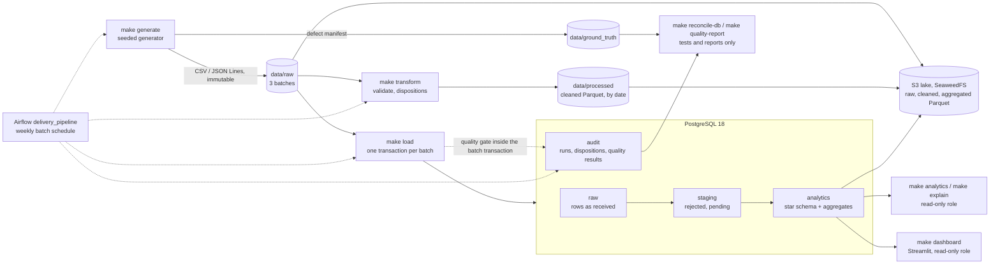

# DeliveryPulse

The optional raw document store uses **MongoDB Community (SSPL-licensed)**: 441,222 source
rows loaded, replayed with zero inserts or modifications, and an eight-row raw-event query
matched PostgreSQL. See [measurements and limitations](docs/benchmarks.md#4-mongodb-raw-event-store-2026-10-15)
and the [design decision](docs/decisions/nosql.md).

[](https://github.com/Aashritha-2005/DeliveryPulse-Last-Mile-Logistics-Data-Platform/actions/workflows/tests.yml)
[](https://github.com/Aashritha-2005/DeliveryPulse-Last-Mile-Logistics-Data-Platform/actions/workflows/security.yml)
[](LICENSE)

A local, reproducible data-engineering project for a simulated last-mile delivery business. It
generates messy delivery data with known defects, cleans it with an idempotent batch pipeline,
loads it into PostgreSQL behind a data-quality gate, and serves analytics. Every defect is
accounted for row by row, and every number below was measured on this repository.

**All data is synthetic.** It is generated locally by `make generate` from a fixed seed and is
not committed. No real people, addresses, phone numbers or GPS traces are used.


*The dashboard (`make dashboard`) on the default dataset: 49,450 orders, 2026-09-10 to
2026-09-30, read through the read-only database role.*

## Architecture



- **Generate.** A seeded generator writes three weekly batches of drivers, orders, delivery
  events and shift events, with 22 injected defect types (duplicates, replays, bad timestamps,
  impossible GPS jumps, orphans, late events and more). It also writes a ground-truth manifest
  of every injected case, which the pipeline never reads.
- **Clean and load.** Every input row gets exactly one disposition: `accepted`, `rejected`,
  `duplicate`, `stale_ignored` or `pending`.
  - `make transform` writes a cleaned Parquet layer.
  - `make load` writes PostgreSQL. Each batch is atomic and idempotent by `batch_id`, failed
    batches are audited in a separate transaction, and affected daily aggregates are
    recomputed incrementally.
- **Quality gate.** 35 checks (50 results) run inside each batch transaction: blocking
  integrity checks, plus raw-layer detection checks that re-derive every defect independently.
  A blocking failure rolls the batch back and records the evidence.
- **Orchestration.** An Airflow 3 DAG, `delivery_pipeline`, runs generate, clean, load, the
  quality gate and the aggregate refresh once per weekly batch window, with catchup over the
  three windows, retries with exponential backoff, timeouts and failure logging. It runs from
  its own Compose file, layered on the core one. A failing quality check stops the run before
  the aggregate refresh, and clearing and rerunning a date leaves the business tables unchanged.
- **Object storage.** `make lake-export` writes raw, cleaned and aggregated Parquet layers,
  partitioned by date, to a local S3-compatible store (SeaweedFS) through the S3 API.
  `make lake-check` reads every object back through S3 and reconciles keys, row counts and bytes
  with the raw files, the cleaned Parquet and the database. The pipeline's key can only read,
  write and list its bucket.
- **Scale benchmark.** `make benchmark` runs the same cleaning and aggregation workload in
  vectorised pandas and in PySpark over 50,000 to 2,000,000 orders, each run in its own process
  with a warm-up and three measured runs, under a 4 GiB memory limit per run and a 4 GiB disk
  budget. It reports where Spark overtakes pandas and where pandas runs out of memory.
- **Local streaming demo.** Kafka order and GPS-ping messages land in
  PostgreSQL with provenance, conflict detection and replay-safe identities. The measured
  correctness run inserted 500 records and sent five malformed records to the DLQ; replay
  inserted zero rows. [Throughput, latency and limitations](docs/benchmarks.md#3-kafka-streaming-2026-10-15).
- **Dashboard.** A Streamlit page on `127.0.0.1:8501`, connected as the read-only role. It
  shows, for a date range and a set of cities:
  - headline KPIs;
  - the daily delivery-time trend per city;
  - the late-delivery rate by city (recomputed from counts);
  - orders by hour of day;
  - the fastest drivers with their utilisation.

## Tech stack

| Area | Tool | Used for |
|---|---|---|
| Language | Python 3.12 | Generator, pipeline, loader, quality checks |
| Dependencies | `uv` with a committed `uv.lock` | Reproducible installs (`uv sync --locked`) |
| Data generation | NumPy (seeded) | Deterministic synthetic data, byte-identical per seed |
| Processing | Plain Python (standard library) | Validation, dispositions and GPS rules, record by record |
| File storage | PyArrow | Parquet I/O for the cleaned and lake layers, partitioned by date |
| Object storage | SeaweedFS 4.48 (S3-compatible) + boto3 | Raw, cleaned and aggregated Parquet lake through the S3 API |
| Benchmark engines | pandas 3.0 and PySpark 4.2 (local mode, Java 21) | `make benchmark`: the same cleaning workload in both, with measured runtime, memory and disk |
| Database | PostgreSQL 18.6 (`postgres:18.6-trixie`) | `raw` / `staging` / `analytics` / `audit` schemas |
| Driver | psycopg 3 | Parameterised SQL, `COPY` bulk loads |
| Configuration | python-dotenv | Settings and passwords from a git-ignored `.env` |
| Dashboard | Streamlit 1.64 (built-in charts) | `make dashboard`; uses pandas, Altair and PyArrow 25. The production pipeline uses plain Python and PyArrow; the benchmark uses pandas directly |
| Orchestration | Apache Airflow 3.3.2 (LocalExecutor) | `delivery_pipeline` DAG: retries, timeouts, quality gate, catchup over the batch windows |
| Containers | Docker Compose (`core` profile; `airflow` and `s3` profiles in their own files) | PostgreSQL, Airflow and the object store, bound to `127.0.0.1`, with a memory limit per container |
| Testing | pytest, pytest-cov | Unit and integration suites, coverage |
| Quality gates | ruff (lint and format), mypy (strict), gitleaks | `make lint`, `make scan` |
| Security checks | pip-audit, bandit, Trivy | `make audit`, `make bandit`; Trivy in CI |
| CI | GitHub Actions | Tests and security workflows on every push and pull request |
| Task runner | GNU Make | Every command below |

## Quick start

Prerequisites: `uv`, Docker with Compose v2, GNU Make, and `gitleaks` (only for `make scan`).

```bash
uv sync --locked              # install the locked dependencies into .venv/
cp .env.example .env          # then replace every CHANGE_ME in .env with a local password
make test                     # unit tests (no services needed)
make up                       # start PostgreSQL and wait until healthy
make generate                 # synthetic dataset: 50,000 orders, seed 42 (written to data/)
make load                     # clean and load all batches through the quality gate
make reconcile-db             # compare stored dispositions with the defect manifest
make quality                  # run every quality check on the database
make analytics                # run the analyst queries as the read-only role
make dashboard                # open http://127.0.0.1:8501 (Ctrl+C to stop)
make test-integration         # integration tests against PostgreSQL
make coverage                 # unit-only, then combined coverage of src/
make s3-up                    # object store; needs the S3_ keys in .env (docs/operations.md)
make transform                # cleaned Parquet layer
make lake-export              # raw, cleaned and aggregated layers to the bucket, through S3
make lake-check               # read every object back and reconcile it with its source
make s3-down                  # stop the object store (keeps its volumes)
make down                     # stop services (keeps the data volume)
```

`make help` lists every target. `make reset-db` deletes the database volume after a typed
confirmation. Operations, recovery and troubleshooting are in
[`docs/operations.md`](docs/operations.md).

## Measured results

All on a MacBook Pro (Apple Silicon, 16 GiB RAM), PostgreSQL 18.6 in Docker Desktop (1 GiB
container limit), dataset `seed-42_orders-50000_cfg-449e309b`, October 2026.

| Measure | Result |
|---|---|
| Input rows (3 batches) | 50,484 orders, 441,222 delivery events, 48,997 shift events, 833 drivers |
| Injected defect cases in the manifest | 4,395 |
| Row reconciliation against the manifest (`make reconcile-db`) | passed: 4,395 cases; input = accepted + rejected + duplicate + stale_ignored + pending for every source and batch |
| Defect detection by the quality checks (`make quality-report`) | 25 / 25 case types detected; observed = manifest count in every batch |
| Full load with the quality gate (`make load`) | 121.88 s for 3 batches |
| Quality checks inside the load | 17.81 / 21.01 / 27.18 s per batch; 0 blocking failures. Of that, ~1.9 s per batch is the `ANALYZE` that gives the planner statistics for the batch's uncommitted rows |
| Whole-database quality run (`make quality`) | 50 checks, 0 blocking failures, 0 warnings, 54.99 s |
| Reloading the same batches | no-op; row counts identical before and after |
| Incremental metric refresh vs full rebuild | identical row counts (`make metrics`) |
| Index tuning, `order_event_summary` (median of 3) | 72.487 ms to 25.323 ms ([benchmarks](docs/benchmarks.md)) |
| Dashboard queries as the read-only role (`make dashboard-check`) | 7 queries in 0.10 s on the full dataset; max RSS 76,120,064 bytes |
| Tests (2026-10-15 final Kubernetes sweep) | 608 unit (10.39 s), 163 PostgreSQL integration (141.40 s), 23 Kubernetes static tests (0.34 s, included in unit total); live kind replay/credential tests: 2 passed (158.10 s, before teardown) |
| Coverage of `src/` (`make coverage`, 2026-10-15) | 76 % unit only (rounded report); 83.64 % combined unit + integration, with no exclusions or gate change |
| Lake export (`make lake-export`) | 118 objects, 1,093,033 rows, 57,501,391 bytes in 8.20 s; a replay rewrites the same objects and deletes nothing. Streaming the objects cut the peak memory from 923,090,944 to 653,492,224 bytes |
| Database size by schema (`make db-sizes`) | 686.9 MiB of project tables: raw 218.7, staging 214.9, audit 174.8, analytics 78.6 MiB |
| Lake read-back (`make lake-check`) | raw 541,536 rows, cleaned 539,047, aggregated 12,450; every key, row count and byte matches its source |
| Airflow DAG parse (`make airflow-dag-check`) | `delivery_pipeline` parses; 5 tasks in order; schedule = the 3 batch windows; retries, backoff, timeouts and callbacks set |
| Airflow DAG run (rerun of the last batch window from the UI) | all 5 tasks succeeded in 2 min 2 s; business-table row counts unchanged |
| Memory, PostgreSQL + Airflow (`make airflow-stats`) | about 1.0-1.1 GiB idle; peak 2.12-2.26 GiB during a DAG run (two runs) |
| Airflow image (`make airflow-image-info`) | 3,821,003,600 bytes, of which 3,252,573,702 are the official base image |
| pandas vs PySpark crossover (`make benchmark`) | about 1,000,000 orders: pandas 43.374 s against Spark 40.919 s. Below it pandas leads (6.6x at 50,000, 1.6x at 500,000); at 2,000,000 only Spark finishes, in 63.169 s |
| Memory at scale, same workload | pandas 530.5 MiB at 50,000 orders up to 4,024.3 MiB at 1,000,000, then killed by the 4 GiB limit at 2,000,000; Spark peaks at 1.33-2.60 GiB and spills up to 1.71 GiB to disk |
| Partitioned vs single-file Parquet read (one week of 21 days, 5,882,587 rows) | no gain: pandas 0.851 s single against 1.28 s partitioned, Spark 8.473 s against 8.442 s ([why](docs/benchmarks.md)) |

## Data quality

- **Defects and dispositions.** The [data quality report](docs/data_quality_report.md) lists
  every injected defect type, its expected disposition, and per-batch counts.
- **Detection.** Its generated "Quality checks" section shows the check that detects each
  type, with the observed and the manifest count side by side.
- **Rules.** The rules, severities, thresholds and the gate are in
  [`docs/data_contracts.md`](docs/data_contracts.md), section 11.

## Testing

- **Unit tests** (`make test`, marker `unit`): cleaning rules, GPS-speed logic, the late flag,
  metric definitions, disposition counting, the quality framework, and a validation of every
  quality check's SQL. They need no services. A fixture makes any database connection fail.
- **Integration tests** (`make test-integration`, marker `integration`), against PostgreSQL in
  a separate `_test` database, each inside a rolled-back transaction:
  - schema and least-privilege roles;
  - the full chain: generate, clean, load, analytics, quality;
  - idempotency and failed-batch recovery;
  - metric correctness against an independent Python reference;
  - one deliberately failing case per quality check;
  - edge cases (empty file, malformed row, duplicate batch, missing required column, extra
    column).
  - orchestration support: loading one more batch per scheduled run, rerunning a date without
    duplicate business rows, and a deliberately failing quality check.
- **Object store tests** (`make test-s3`, marker `s3`), against PostgreSQL and the live store,
  in a throw-away prefix: export, read-back check and replay; the pipeline key cannot create
  buckets or write to another bucket.
- **Benchmark engine tests** (`make test-spark`, marker `spark`), needing only a Java 21
  runtime: the pandas and the PySpark engine must return identical counts and aggregates on the
  fixture dataset, on several shards, and on both read layouts.
- **Kafka tests** (`make test-kafka`, marker `kafka`), against the single broker and PostgreSQL:
  valid delivery, malformed records in the DLQ, replay and restart after a committed write.
- **MongoDB tests** (`make test-mongo`, marker `mongo`): raw-document loading, replay,
  query equality and restricted database roles, with the optional MongoDB service running.
- **Kubernetes tests** (`make test-k8s`, marker `k8s`): local kind replay against an already
  populated PostgreSQL database and clean wrong-credential failure. The static manifest and
  stage-guard tests (`make test-k8s-manifests`) also run in the unit suite.
- **Attribution.** Every test carries exactly one of the seven markers; collection stops
  otherwise, so a failure always belongs to one suite.

## Continuous integration

Two GitHub Actions workflows run on every push to `main` and on every pull request. Both use a
read-only token and no repository secrets. Every action is pinned to a full commit SHA and the
PostgreSQL, Airflow and SeaweedFS images to their digests.

| Workflow | Jobs |
|---|---|
| [`tests.yml`](.github/workflows/tests.yml) | Lint and type check (+ workflow validation); unit tests with no services; integration tests and the 80 % coverage gate against PostgreSQL started by `make up` with passwords generated in the job; Airflow DAG parse check; object store tests against SeaweedFS started by `make s3-up` with keys generated in the job; pandas/PySpark equivalence tests on the runner's Java 21; determinism check (`make generate-check`) on Linux |
| [`security.yml`](.github/workflows/security.yml) (also weekly) | gitleaks on the working tree and the full git history; pip-audit on every locked package; bandit on `src/` and the Python files in `scripts/`; Trivy on the repository (gating) and on the PostgreSQL, Airflow and SeaweedFS images (report only) |

CI generates its own small dataset; no data is committed. Dependabot proposes weekly updates for
the actions, the Python lockfile, the Compose images and the Airflow/pipeline Dockerfiles.
A pipeline image build, entry-point smoke check and gating image scan run in `security.yml`;
the GitHub run passed on 2026-10-15. CI creates no kind cluster.
Security reports: [SECURITY.md](SECURITY.md).

## Repository layout

```
├── .github/               CI workflows (tests, security) and Dependabot
├── Makefile               every command (make help)
├── SECURITY.md            how to report a vulnerability
├── docker-compose.yml     PostgreSQL (core profile), localhost only
├── docker-compose.airflow.yml
│                          Airflow services and the DAG parse check, layered on the core file
├── docker-compose.s3.yml  object store (SeaweedFS) and its key-file writer, layered on the core file
├── docker/postgres/       init script: roles, schema, indexes, grants
├── docker/airflow/        Airflow image with the project's runtime environment
├── dags/                  the delivery_pipeline DAG
├── sql/                   schema, roles, grants, indexes, analyst and dashboard queries
├── src/
│   ├── ingestion/         seeded generator and defect injection
│   ├── transformations/   validation, dispositions, GPS rules, Parquet output
│   ├── database/          idempotent loader, metrics refresh, analytics runner
│   ├── orchestration/     batch windows and the command of each DAG task
│   ├── lake/              S3 lake: bucket bootstrap, layer export, read-back reconciliation
│   ├── bench/             benchmark workload: shards, pandas and PySpark engines, disk guard
│   ├── quality/           data-quality checks and the quality gate
│   ├── dashboard/         Streamlit dashboard (read-only role) and its data access
│   └── groundtruth/       manifest verification and reconciliation (tests and reports only)
├── tests/
│   ├── unit/              no services
│   └── integration/       needs PostgreSQL (test_lake_live.py: also the object store)
├── scripts/               shell helpers used by make targets, and the benchmark harness
└── docs/                  contracts, data model, operations, benchmarks, quality report
```

Further reading: [data contracts](docs/data_contracts.md) ·
[data model](docs/data_model.md) · [operations](docs/operations.md) ·
[benchmarks](docs/benchmarks.md) · [data quality report](docs/data_quality_report.md).

## Run the pipeline on local Kubernetes (kind)

The measured one-node kind Job ran against Compose PostgreSQL **already holding the dataset**.
Every Kubernetes load skipped all three batches: **0 loaded, 3 skipped**. This demonstrates
that the pipeline Job runs on kind and is idempotent, including metric refresh and the quality
gate. It does **not** demonstrate a first-time Kubernetes load into an empty database. The
source-identity guard deliberately requires the three successful database batches first.
See [measurements](docs/benchmarks.md#local-kubernetes-measured-local-run-2026-10-15) and
[design/security decisions](docs/decisions/kubernetes.md).

Prerequisites on the tested Mac: Docker Desktop running; kind **v0.33.x** (tested v0.33.0);
Homebrew kubectl **v1.37.x** at `/opt/homebrew/bin/kubectl` (tested v1.37.1); `uv`, Make and
the locked development environment from Quick start. Docker Desktop's bundled kubectl
v1.36.1 is rejected. `KUBECTL` and `KIND` are overridable Make variables for other hosts.
Configure the existing PostgreSQL settings and ETL password locally as described in Quick
start. Never print or commit credentials. Kafka, MongoDB, Airflow and the object store must
be stopped. No concurrent pipeline writer may run during the comparison.

Run these prerequisites from the repository root. The default 50,000-order seed-42 dataset
must already be generated and loaded; these commands establish that prerequisite if needed.
Do not reset an existing database or switch its dataset for this demo.

```bash
export PATH="/Applications/Docker.app/Contents/Resources/bin:$PATH"
uv sync --locked
make up
make generate ORDERS=50000 SEED=42
make load
make db-counts
```

Expect PostgreSQL healthy, dataset `seed-42_orders-50000_cfg-449e309b`, three successful
batches (or three skips on replay), 49,450 analytics orders and 439,822 delivery events.
If source identity or counts differ, stop and investigate before Kubernetes setup.

Start with **at least 16 GiB physical host free space recommended**; the build refuses below
13.5 GiB. The hard floor is 10 GiB and cancellation threshold is 11 GiB. Every stage checks
again: cluster creation requires 12.8 GiB; load requires `11 + 2 × image size in GiB + 0.3`;
Jobs require 12.5 GiB. Stop at any failed checkpoint. Docker VM free blocks and cache-prune
totals are not reclaimed host space. Recheck actual host space after cleanup.

Run **one command at a time**, reviewing its output before the next. The PATH export above
applies to every command. Do not paste the whole sequence as an unattended script.

```bash
make k8s-preflight
make k8s-build
make k8s-cache-clean
make k8s-up
make k8s-load
make k8s-image-info
make k8s-secret
make k8s-run
make db-counts
make k8s-replay
make db-counts
make test-k8s
make k8s-status
make k8s-stats
```

| Command | What to check before continuing |
|---|---|
| `k8s-preflight` | Disk checkpoint; selected kind/kubectl versions; Docker architecture/memory; `Kubernetes preflight: passed (no cluster created)` |
| `k8s-build` | JSON with the content-derived tag, image ID, byte size and `loaded: false`; successful final disk checkpoint. Output may be quiet during the build |
| `k8s-cache-clean` | Type `DELETE` to remove unused build cache, including cache from other projects; no volumes or tagged pipeline image removed. Docker reports its reclaimed total; physical host space may not increase immediately |
| `k8s-up` | Actual `create_seconds`, node filesystem usage and final disk checkpoint. Creates one pinned node, localhost API and a private kubeconfig under ignored `data/k8s/` |
| `k8s-load` | Ordered rootfs layers match the saved host build; config digests match when both stores expose them. Different/missing layers fail. Never accept tags alone |
| `k8s-image-info` | Read-only host/node image identifiers and ordered layer arrays; no rebuild or export |
| `k8s-secret` | `Kubernetes PostgreSQL connectivity: passed`; Secret values not shown; CronJob suspended. Selects only the ETL credential, sends it on stdin and never writes a Secret file |
| `k8s-run` | Dataset identity verified before writes; `0 batches loaded, 3 already loaded (skipped)`; 50 quality checks with 0 blocking failures and 0 warnings; analytics counts/content hashes unchanged |
| `k8s-replay` and surrounding `db-counts` | All business tables and aggregates identical, including hashes; audit quality-run counts may increase |
| `test-k8s` | Both live tests pass: replay equality and a clean wrong-credential failure. Only temporary test Secret/Jobs are cleaned up |
| `k8s-status` | CronJob suspended, no active successful Jobs left; `secret/deliverypulse-db` confirms the real Secret by name only |
| `k8s-stats` | Image size, saved Job timings, node memory samples, physical host free bytes and node filesystem usage. Samples are not continuous application peaks |

Successful Jobs save evidence before their built-in cleanup removes temporary pod storage.
The CronJob stays suspended. **Keep the host pipeline image until the final cleanup**, so
recreating a failed cluster does not require rebuilding it. For diagnosis use `make k8s-status`
and `make k8s-logs`; stop on a failure, especially connectivity or identity mismatch. Never
widen PostgreSQL's localhost port binding to resolve a connection failure.

Final cleanup, after reviewing/saving results (one command at a time):

```bash
make k8s-host-image-clean
make k8s-down
```

The first command re-verifies the node copy and removes only the host pipeline image tag.
It must precede cluster deletion. The second asks for `DELETE` and removes the throwaway
cluster, its Kubernetes Secrets and remaining pods; it leaves Compose volumes and PostgreSQL
untouched. Both print fresh disk checkpoints. Removing Docker data may not immediately return
physical host space. Obtain explicit deletion approval when running through an automation
session. See the [operations runbook](docs/operations.md#local-kubernetes-staged-runbook) for
disk recovery and limitations. The local staged run and CI pipeline image build/scan passed
on 2026-10-15. A second, independent from-scratch README reproduction is deferred to the
pre-publishing check to conserve laptop disk space; it has not been performed.

## Known limitations

- **Scope.** Local batch processing and a single-broker streaming landing demo. Streaming uses
  stateless contract rules and writes only to `raw.stream_events`; it does not update analytics
  or the lake.
  See [Kafka setup and demo commands](docs/operations.md#kafka-streaming-setup).
  Distributed deployment and cloud resources are not implemented.
- **The lake is local and write-only for the pipeline.** It runs on a local SeaweedFS store;
  real AWS S3 is a settings change but has not been used. No pipeline stage reads the lake yet;
  `make lake-check` reads it back to prove it matches its sources. The export streams one object
  at a time (peak 653,492,224 bytes for the default dataset); one batch's records still fit in
  memory. SeaweedFS reached 403 MiB
  after two exports (its limit is 768 MiB).
- **The quality gate roughly doubles the load time** (about 66 s of 121.88 s).
  - The checks analyze the tables they read first, so the planner knows the batch's uncommitted
    rows. That replaced an earlier planner override (nested-loop joins disabled) and is the
    correct fix, but it did not make the load faster: the `ANALYZE` itself costs about 1.9 s per
    batch, roughly what the override had saved.
  - Cross-batch raw checks read all earlier batches, so their cost grows with history.
- **The database is about 8× the raw input** (686 MB for 87 MB of raw files). The audit trail
  keeps one disposition row per input row.
- **One dataset per database.** Switching datasets requires `make reset-db`.
- **GPS rule.** A late GPS ping is checked against its predecessor only, not its successor
  (documented in the data contract).
- **Driver utilisation above 100 %** is stored as computed, not capped. The quality check
  reports it, except while a shift session is still open at a batch cutoff.
- **Driver utilisation is low:** 3.75 % to 22.76 % per driver over the whole period, median
  12.14 %. The generator sizes the fleet generously to keep no-free-driver cancellations under
  5 %; this reflects the synthetic data, not a pipeline issue.
- **The dashboard is a local tool.** It is bound to `127.0.0.1` with no login, and reads
  synthetic data through the read-only role. Streamlit's XSRF and CORS protections stay at
  their defaults.
- **Airflow is heavy for a laptop.** PostgreSQL plus Airflow peak at 2.12-2.26 GiB during a run,
  and the image is 3.8 GB, mostly the official Airflow base image. The Airflow UI uses the
  development-only simple auth manager with a generated password, bound to `127.0.0.1`.
- **The benchmark workload is not the pipeline.** `make benchmark` runs a defined vectorised
  subset of the cleaning rules in pandas and in PySpark, proved identical **to each other**, not
  to the production engine, which keeps its stateful disposition logic in plain Python. The
  benchmark answers where Spark overtakes pandas, not whether the pipeline is correct.
- **Spark is not part of the pipeline.** It is an extra dependency group and needs Java 21; no
  pipeline command uses it. 5,000,000 orders was not benchmarked because it would exceed the
  4 GiB disk budget the benchmark holds itself to.
- **Coverage.** Unit-only coverage is 76 % (rounded report); combined unit/PostgreSQL
  integration coverage is 83.64 %. Some command-line/report paths remain uncovered. The
  object-store, Spark, Kafka, MongoDB and Kubernetes live suites are not included. Coverage
  measures `src/`; Kubernetes helpers in `scripts/` have direct regression tests, lint/type
  checks and security scans but are outside that existing coverage scope.
