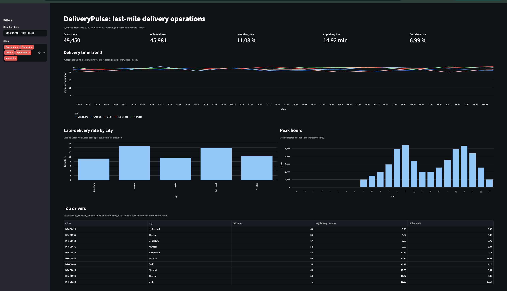
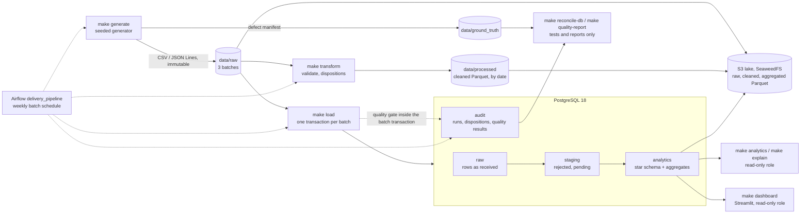

# DeliveryPulse

[](https://github.com/Aashritha-2005/DeliveryPulse-Last-Mile-Logistics-Data-Platform/actions/workflows/tests.yml)
[](https://github.com/Aashritha-2005/DeliveryPulse-Last-Mile-Logistics-Data-Platform/actions/workflows/security.yml)
[](LICENSE)

A local, reproducible data-engineering project for a simulated last-mile delivery business. It
generates messy delivery data with known defects, cleans it with an idempotent batch pipeline,
loads it into PostgreSQL behind a data-quality gate, and serves analytics. Every defect is
accounted for row by row, and every number below was measured on this repository.

**All data is synthetic.** It is generated locally by `make generate` from a fixed seed and is
not committed. No real people, addresses, phone numbers or GPS traces are used.



*The dashboard (`make dashboard`) on the default dataset: 49,450 orders, 2026-09-10 to
2026-09-30, read through the read-only database role.*

## Architecture



- **Generate.** A seeded generator writes three weekly batches of drivers, orders, delivery
  events and shift events, with 22 injected defect types (duplicates, replays, bad timestamps,
  impossible GPS jumps, orphans, late events and more). It also writes a ground-truth manifest
  of every injected case, which the pipeline never reads.
- **Clean and load.** Every input row gets exactly one disposition: `accepted`, `rejected`,
  `duplicate`, `stale_ignored` or `pending`.
  - `make transform` writes a cleaned Parquet layer.
  - `make load` writes PostgreSQL. Each batch is atomic and idempotent by `batch_id`, failed
    batches are audited in a separate transaction, and affected daily aggregates are
    recomputed incrementally.
- **Quality gate.** 35 checks (50 results) run inside each batch transaction: blocking
  integrity checks, plus raw-layer detection checks that re-derive every defect independently.
  A blocking failure rolls the batch back and records the evidence.
- **Orchestration.** An Airflow 3 DAG, `delivery_pipeline`, runs generate, clean, load, the
  quality gate and the aggregate refresh once per weekly batch window, with catchup over the
  three windows, retries with exponential backoff, timeouts and failure logging. It runs from
  its own Compose file, layered on the core one. A failing quality check stops the run before
  the aggregate refresh, and clearing and rerunning a date leaves the business tables unchanged.
- **Object storage.** `make lake-export` writes raw, cleaned and aggregated Parquet layers,
  partitioned by date, to a local S3-compatible store (SeaweedFS) through the S3 API.
  `make lake-check` reads every object back through S3 and reconciles keys, row counts and bytes
  with the raw files, the cleaned Parquet and the database. The pipeline's key can only read,
  write and list its bucket.
- **Dashboard.** A Streamlit page on `127.0.0.1:8501`, connected as the read-only role. It
  shows, for a date range and a set of cities:
  - headline KPIs;
  - the daily delivery-time trend per city;
  - the late-delivery rate by city (recomputed from counts);
  - orders by hour of day;
  - the fastest drivers with their utilisation.

## Tech stack

| Area | Tool | Used for |
|---|---|---|
| Language | Python 3.12 | Generator, pipeline, loader, quality checks |
| Dependencies | `uv` with a committed `uv.lock` | Reproducible installs (`uv sync --locked`) |
| Data generation | NumPy (seeded) | Deterministic synthetic data, byte-identical per seed |
| Processing | Plain Python (standard library) | Validation, dispositions and GPS rules, record by record |
| File storage | PyArrow | Parquet I/O for the cleaned and lake layers, partitioned by date |
| Object storage | SeaweedFS 4.48 (S3-compatible) + boto3 | Raw, cleaned and aggregated Parquet lake through the S3 API |
| Database | PostgreSQL 18.6 (`postgres:18.6-trixie`) | `raw` / `staging` / `analytics` / `audit` schemas |
| Driver | psycopg 3 | Parameterised SQL, `COPY` bulk loads |
| Configuration | python-dotenv | Settings and passwords from a git-ignored `.env` |
| Dashboard | Streamlit 1.64 (built-in charts) | `make dashboard`; pandas, Altair and PyArrow 25 arrive only as Streamlit's dependencies, and the pipeline itself does not use pandas |
| Orchestration | Apache Airflow 3.3.2 (LocalExecutor) | `delivery_pipeline` DAG: retries, timeouts, quality gate, catchup over the batch windows |
| Containers | Docker Compose (`core` profile; `airflow` and `s3` profiles in their own files) | PostgreSQL, Airflow and the object store, bound to `127.0.0.1`, with a memory limit per container |
| Testing | pytest, pytest-cov | Unit and integration suites, coverage |
| Quality gates | ruff (lint and format), mypy (strict), gitleaks | `make lint`, `make scan` |
| Security checks | pip-audit, bandit, Trivy | `make audit`, `make bandit`; Trivy in CI |
| CI | GitHub Actions | Tests and security workflows on every push and pull request |
| Task runner | GNU Make | Every command below |

## Quick start

Prerequisites: `uv`, Docker with Compose v2, GNU Make, and `gitleaks` (only for `make scan`).

```bash
uv sync --locked              # install the locked dependencies into .venv/
cp .env.example .env          # then replace every CHANGE_ME in .env with a local password
make test                     # unit tests (no services needed)
make up                       # start PostgreSQL and wait until healthy
make generate                 # synthetic dataset: 50,000 orders, seed 42 (written to data/)
make load                     # clean and load all batches through the quality gate
make reconcile-db             # compare stored dispositions with the defect manifest
make quality                  # run every quality check on the database
make analytics                # run the analyst queries as the read-only role
make dashboard                # open http://127.0.0.1:8501 (Ctrl+C to stop)
make test-integration         # integration tests against PostgreSQL
make coverage                 # unit-only, then combined coverage of src/
make s3-up                    # object store; needs the S3_ keys in .env (docs/operations.md)
make transform                # cleaned Parquet layer
make lake-export              # raw, cleaned and aggregated layers to the bucket, through S3
make lake-check               # read every object back and reconcile it with its source
make s3-down                  # stop the object store (keeps its volumes)
make down                     # stop services (keeps the data volume)
```

`make help` lists every target. `make reset-db` deletes the database volume after a typed
confirmation. Operations, recovery and troubleshooting are in
[`docs/operations.md`](docs/operations.md).

## Measured results

All on a MacBook Pro (Apple Silicon, 16 GiB RAM), PostgreSQL 18.6 in Docker Desktop (1 GiB
container limit), dataset `seed-42_orders-50000_cfg-449e309b`, October 2026.

| Measure | Result |
|---|---|
| Input rows (3 batches) | 50,484 orders, 441,222 delivery events, 48,997 shift events, 833 drivers |
| Injected defect cases in the manifest | 4,395 |
| Row reconciliation against the manifest (`make reconcile-db`) | passed: 4,395 cases; input = accepted + rejected + duplicate + stale_ignored + pending for every source and batch |
| Defect detection by the quality checks (`make quality-report`) | 25 / 25 case types detected; observed = manifest count in every batch |
| Full load with the quality gate (`/usr/bin/time -l make load`) | 113.49 s; max RSS 618,299,392 bytes |
| Quality checks inside the load | 16.50 / 21.31 / 22.43 s per batch; 0 blocking failures |
| Whole-database quality run (`make quality`) | 50 checks, 0 blocking failures, 0 warnings, 54.99 s |
| Reloading the same batches | no-op; row counts identical before and after |
| Incremental metric refresh vs full rebuild | identical row counts (`make metrics`) |
| Index tuning, `order_event_summary` (median of 3) | 72.487 ms to 25.323 ms ([benchmarks](docs/benchmarks.md)) |
| Dashboard queries as the read-only role (`make dashboard-check`) | 7 queries in 0.10 s on the full dataset; max RSS 76,120,064 bytes |
| Tests | 405 unit (no services, 8.74 s), 150 integration (105.92 s) and 3 against the live object store (8.21 s) |
| Coverage of `src/` (`make coverage`) | 77 % unit only; 85.92 % combined unit + integration, with no exclusions |
| Lake export (`make lake-export`) | 118 objects, 1,093,033 rows, 57,501,391 bytes in 9.02 s; a replay rewrites the same objects and deletes nothing |
| Lake read-back (`make lake-check`) | raw 541,536 rows, cleaned 539,047, aggregated 12,450; every key, row count and byte matches its source |
| Airflow DAG parse (`make airflow-dag-check`) | `delivery_pipeline` parses; 5 tasks in order; schedule = the 3 batch windows; retries, backoff, timeouts and callbacks set |
| Airflow DAG run (rerun of the last batch window from the UI) | all 5 tasks succeeded in 2 min 2 s; business-table row counts unchanged |
| Memory, PostgreSQL + Airflow (`make airflow-stats`) | about 1.0-1.1 GiB idle; peak 2.12-2.26 GiB during a DAG run (two runs) |
| Airflow image (`make airflow-image-info`) | 3,821,003,600 bytes, of which 3,252,573,702 are the official base image |

## Data quality

- **Defects and dispositions.** The [data quality report](docs/data_quality_report.md) lists
  every injected defect type, its expected disposition, and per-batch counts.
- **Detection.** Its generated "Quality checks" section shows the check that detects each
  type, with the observed and the manifest count side by side.
- **Rules.** The rules, severities, thresholds and the gate are in
  [`docs/data_contracts.md`](docs/data_contracts.md), section 11.

## Testing

- **Unit tests** (`make test`, marker `unit`): cleaning rules, GPS-speed logic, the late flag,
  metric definitions, disposition counting, the quality framework, and a validation of every
  quality check's SQL. They need no services. A fixture makes any database connection fail.
- **Integration tests** (`make test-integration`, marker `integration`), against PostgreSQL in
  a separate `_test` database, each inside a rolled-back transaction:
  - schema and least-privilege roles;
  - the full chain: generate, clean, load, analytics, quality;
  - idempotency and failed-batch recovery;
  - metric correctness against an independent Python reference;
  - one deliberately failing case per quality check;
  - edge cases (empty file, malformed row, duplicate batch, missing required column, extra
    column).
  - orchestration support: loading one more batch per scheduled run, rerunning a date without
    duplicate business rows, and a deliberately failing quality check.
- **Object store tests** (`make test-s3`, marker `s3`), against PostgreSQL and the live store,
  in a throw-away prefix: export, read-back check and replay; the pipeline key cannot create
  buckets or write to another bucket.
- **Attribution.** Every test carries exactly one of the three markers; collection stops
  otherwise, so a failure always belongs to one suite.

## Continuous integration

Two GitHub Actions workflows run on every push to `main` and on every pull request. Both use a
read-only token and no repository secrets. Every action is pinned to a full commit SHA and the
PostgreSQL, Airflow and SeaweedFS images to their digests.

| Workflow | Jobs |
|---|---|
| [`tests.yml`](.github/workflows/tests.yml) | Lint and type check (+ workflow validation); unit tests with no services; integration tests and the 80 % coverage gate against PostgreSQL started by `make up` with passwords generated in the job; Airflow DAG parse check; object store tests against SeaweedFS started by `make s3-up` with keys generated in the job; determinism check (`make generate-check`) on Linux |
| [`security.yml`](.github/workflows/security.yml) (also weekly) | gitleaks on the working tree and the full git history; pip-audit on every locked package; bandit on `src/`; Trivy on the repository (gating) and on the PostgreSQL, Airflow and SeaweedFS images (report only) |

CI generates its own small dataset; no data is committed. Dependabot proposes weekly updates for
the actions, the Python lockfile, the Compose images and the Airflow Dockerfile. Security reports: [SECURITY.md](SECURITY.md).

## Repository layout

```
├── .github/               CI workflows (tests, security) and Dependabot
├── Makefile               every command (make help)
├── SECURITY.md            how to report a vulnerability
├── docker-compose.yml     PostgreSQL (core profile), localhost only
├── docker-compose.airflow.yml
│                          Airflow services and the DAG parse check, layered on the core file
├── docker-compose.s3.yml  object store (SeaweedFS) and its key-file writer, layered on the core file
├── docker/postgres/       init script: roles, schema, indexes, grants
├── docker/airflow/        Airflow image with the project's runtime environment
├── dags/                  the delivery_pipeline DAG
├── sql/                   schema, roles, grants, indexes, analyst and dashboard queries
├── src/
│   ├── ingestion/         seeded generator and defect injection
│   ├── transformations/   validation, dispositions, GPS rules, Parquet output
│   ├── database/          idempotent loader, metrics refresh, analytics runner
│   ├── orchestration/     batch windows and the command of each DAG task
│   ├── lake/              S3 lake: bucket bootstrap, layer export, read-back reconciliation
│   ├── quality/           data-quality checks and the quality gate
│   ├── dashboard/         Streamlit dashboard (read-only role) and its data access
│   └── groundtruth/       manifest verification and reconciliation (tests and reports only)
├── tests/
│   ├── unit/              no services
│   └── integration/       needs PostgreSQL (test_lake_live.py: also the object store)
├── scripts/               shell helpers used by make targets
└── docs/                  contracts, data model, operations, benchmarks, quality report
```

Further reading: [data contracts](docs/data_contracts.md) ·
[data model](docs/data_model.md) · [operations](docs/operations.md) ·
[benchmarks](docs/benchmarks.md) · [data quality report](docs/data_quality_report.md).

## Known limitations

- **Scope.** Batch and local only. Streaming, distributed processing and cloud resources are not
  in this repository yet.
- **The lake is local and write-only for the pipeline.** It runs on a local SeaweedFS store;
  real AWS S3 is a settings change but has not been used. No pipeline stage reads the lake yet;
  `make lake-check` reads it back to prove it matches its sources. The export builds the whole
  lake in memory first (peak 923 MB for the default dataset), and SeaweedFS reached 403 MiB
  after two exports (its limit is 768 MiB).
- **The quality gate roughly doubles the load time** (about 60 s of 113.49 s).
  - The checks run with nested-loop joins disabled, because the batch's uncommitted rows have
    no planner statistics.
  - Cross-batch raw checks read all earlier batches, so their cost grows with history.
- **The database is about 8× the raw input** (686 MB for 87 MB of raw files). The audit trail
  keeps one disposition row per input row.
- **One dataset per database.** Switching datasets requires `make reset-db`.
- **GPS rule.** A late GPS ping is checked against its predecessor only, not its successor
  (documented in the data contract).
- **Driver utilisation above 100 %** is stored as computed, not capped. The quality check
  reports it, except while a shift session is still open at a batch cutoff.
- **Driver utilisation is low:** 3.75 % to 22.76 % per driver over the whole period, median
  12.14 %. The generator sizes the fleet generously to keep no-free-driver cancellations under
  5 %; this reflects the synthetic data, not a pipeline issue.
- **The dashboard is a local tool.** It is bound to `127.0.0.1` with no login, and reads
  synthetic data through the read-only role. Streamlit's XSRF and CORS protections stay at
  their defaults.
- **Airflow is heavy for a laptop.** PostgreSQL plus Airflow peak at 2.12-2.26 GiB during a run,
  and the image is 3.8 GB, mostly the official Airflow base image. The Airflow UI uses the
  development-only simple auth manager with a generated password, bound to `127.0.0.1`.
- **Coverage.** Unit-only coverage is 77 %. The command-line entry points and report writers
  are exercised by `make` targets rather than by pytest, and the object store tests are not
  counted in the coverage figure.
