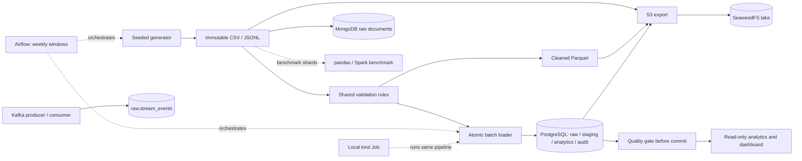

# Architecture

The default system is a local batch pipeline backed by PostgreSQL. Optional services have
separate lifecycle commands and do not start with the isolated core demo. All records are
synthetic and all displayed performance claims refer to dated local measurements.

The loader runs the same validation rules as the standalone Parquet transform; it does not
load the transform's Parquet output. Each batch transaction includes raw preservation,
dispositions, business writes, metric refresh and the blocking quality gate. Failures roll
back that transaction and are recorded separately in audit metadata.

| Boundary | Command | Scope |
|---|---|---|
| Isolated core demo | `make demo`, `make demo-down` | 5,000 orders, seed 42; current 500-driver configuration verified offline only; live timing covers the earlier 83-driver configuration |
| Main batch dataset | `make generate`, `make transform`, `make load` | Content-derived identities; retries and late/orphan handling |
| Evidence | `make reconcile-db`, `make quality-report` | Manifest verification; production classification never reads ground truth |
| Read-only access | `make analytics`, `make dashboard` | Analytics role; no raw-table grants |
| Airflow | `make airflow-up` | Existing tasks scheduled by weekly window; retries and failure gate |
| Lake | `make s3-up`, `make lake-export`, `make lake-check` | Table/date Parquet; export and read-back only |
| Scale | `make benchmark` | Separate vectorised pandas/Spark subset; no production-state equivalence claim |
| Streaming | `make kafka-up`, `make kafka-demo` | Kafka to `raw.stream_events`; DLQ, provenance and replay checks; no analytics updates |
| Documents | `make mongo-up`, `make mongo-load`, `make mongo-query` | Source-row documents, insert-only replay and one SQL comparison |
| Kubernetes | staged `make k8s-*` | One local node, restricted pods; existing-dataset replay only |

AWS is deliberately omitted: the endpoint guard exists, but no AWS workload was run. Use one
heavy optional profile at a time. Resource limits, local plaintext choices, credentials,
start/stop and recovery are documented in [operations](operations.md).

The core demo uses `docker-compose.demo.yml` alone. Its `deliverypulse_demo_pgdata` volume is
explicitly named because changing only the Compose project would not isolate the main
Compose file's explicitly named volume. It never runs `make reset-db` or `make down`.

See the [data model](data_model.md) for table grains and declared versus logical relationships.
