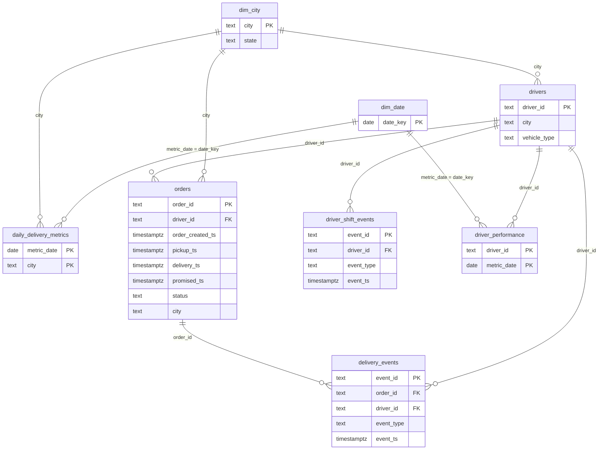

# Data model

The analytics schema is a small star schema for analysts and dashboards. This page explains
what each table means, its grain, and how every metric is defined, so the data can be used
without asking. The source contract is in [data_contracts.md](data_contracts.md); the
validation and dispositions that decide which records reach `analytics` are described there
(sections 6 and 7).

All data is synthetic. All timestamps are stored in UTC (`timestamptz`). Reporting dates and
hours use **Asia/Kolkata** (UTC+05:30, no daylight saving).

## 1. Schemas

| Schema | Holds | Constraints |
|---|---|---|
| `raw` | Every source row exactly as received, with `batch_id` and `ingested_at`. Append-only | Permissive text columns |
| `staging` | Rejected records with reasons, pending (orphan) records, pipeline state | Keys only |
| `analytics` | Accepted records only, plus dimensions and aggregates | Full PK, FK, `NOT NULL`, `CHECK` |
| `audit` | Batch runs, per-row dispositions, pending resolutions | Keys only |

`deliverypulse_readonly` (dashboards, `make analytics`, `make explain`) can read `analytics`
only.

### Streaming landing table

`raw.stream_events` stores the original Kafka value bytes after stateless validation. Its
primary key is `(record_kind, record_key, record_version)`: orders use their ID and canonical
UTC `source_updated_at`; immutable driver pings use their event ID and an empty version.
Identity does not include dataset, topic, offset or send time, so republishing the same source
record cannot create another row. Older order versions remain separate immutable records;
this table does not select a latest version or update analytics.

`content_hash` is the SHA-256 of canonical source fields. The consumer must compare it on
conflict: identical content is a duplicate, different content goes to the dead-letter topic.
The first insert retains `source_dataset`, `source_file`, `source_row_number`,
`kafka_cluster_id`, `kafka_topic`, `kafka_partition`, `kafka_offset`, `produced_at` and
`ingested_at`. A replay never replaces that provenance. No CHECK or foreign-key constraints
are added here; parent waiting and historical GPS checks remain outside this landing path.
The ETL role has SELECT and INSERT only; the read-only dashboard role has no access.

## 2. Star schema

- **Facts:** `orders` (one row per order, latest accepted version) and `delivery_events` (one
  row per unique event). `driver_shift_events` is a supporting fact for utilisation.
- **Dimensions:** `drivers`, `dim_date` and `dim_city`. Declared foreign keys exist only to
  `drivers` and `orders`. `dim_date` and `dim_city` join by value (`metric_date = date_key`,
  `city = city`).
  - `dim_date` is always exactly the continuous range from the first to the last reporting date
    with data (any order timestamp or shift event). Every load and the full rebuild apply this
    same rule, so its content never depends on the path. A batch's refreshed dates (shift dates
    ±1 day) are not used for it.
  - `dim_city` gains every city of a loaded order or driver.
- **Aggregates:** `daily_delivery_metrics` and `driver_performance`, maintained incrementally
  on every load (section 5).

## 3. Grains

| Table | Grain |
|---|---|
| `orders` | One row per order |
| `delivery_events` | One row per unique event |
| `driver_shift_events` | One row per unique shift event |
| `drivers` | One row per driver |
| `dim_date` | One row per reporting date |
| `dim_city` | One row per city |
| `daily_delivery_metrics` | One row per city per reporting date |
| `driver_performance` | One row per driver per reporting date |

**Joining facts:** `orders` to `delivery_events` is one-to-many. Aggregate events to order grain
**before** joining (see `order_event_summary` in `sql/analytics.sql`), otherwise order counts
multiply. An integration test checks that the summary's order count equals the direct count,
while a naive join gives a larger number.

## 4. Data dictionary

### 4.1 `analytics.orders`

| Column | Type | Meaning |
|---|---|---|
| `order_id` | text, PK | Order key (`ORD-NNNNNNN`) |
| `customer_id` | text | Synthetic customer key |
| `driver_id` | text, FK drivers | Assigned driver; `NULL` while unassigned and for cancelled orders |
| `order_created_ts` | timestamptz | When the customer placed the order |
| `pickup_ts` | timestamptz | When the driver picked it up; set for `picked_up` and `delivered` |
| `delivery_ts` | timestamptz | When it was delivered; set only for `delivered` |
| `promised_ts` | timestamptz | Delivery time promised to the customer |
| `distance_km` | numeric(7,3) | Route distance, kilometres |
| `status` | text | `created`, `assigned`, `picked_up`, `delivered`, `cancelled` |
| `city` | text | City of the order |
| `fare_amount` | numeric(10,2) | Fare in INR |
| `source_updated_at` | timestamptz | Version of the source record; only a newer version replaces a row |

### 4.2 `analytics.delivery_events`

| Column | Type | Meaning |
|---|---|---|
| `event_id` | text, PK | Stable event key; replays are deduplicated on it |
| `order_id` | text, FK orders | The order |
| `driver_id` | text, FK drivers | The driver |
| `event_type` | text | `assigned`, `picked_up`, `gps_ping`, `delivered`, `cancelled` |
| `event_ts` | timestamptz | When the event happened (not when it arrived) |
| `lat`, `lon` | double precision | WGS84 position; always set for `gps_ping` |

### 4.3 `analytics.drivers`

| Column | Type | Meaning |
|---|---|---|
| `driver_id` | text, PK | Driver key (`DRV-NNNNN`) |
| `city` | text | Home city |
| `vehicle_type` | text | `bicycle`, `scooter`, `motorbike`, `car` |
| `joined_date` | date | Date the driver joined (reporting timezone) |
| `rating` | numeric(3,2) | Customer rating 1–5; `NULL` if not rated yet |

### 4.4 `analytics.driver_shift_events`

| Column | Type | Meaning |
|---|---|---|
| `event_id` | text, PK | Stable event key |
| `driver_id` | text, FK drivers | The driver |
| `event_type` | text | `online`, `offline`, `break_start`, `break_end` |
| `event_ts` | timestamptz | When it happened |

### 4.5 `analytics.dim_date`

| Column | Type | Meaning |
|---|---|---|
| `date_key` | date, PK | Reporting date (Asia/Kolkata) |
| `calendar_year`, `quarter`, `month`, `day_of_month` | smallint | Calendar parts |
| `iso_day_of_week` | smallint | 1 = Monday … 7 = Sunday |
| `iso_week` | smallint | ISO week number |
| `is_weekend` | boolean | Saturday or Sunday |

### 4.6 `analytics.dim_city`

| Column | Type | Meaning |
|---|---|---|
| `city` | text, PK | City name |
| `state` | text | Indian state or union territory (`Unknown` for a city not in `CITY_STATES`) |

### 4.7 `analytics.daily_delivery_metrics`

One row per city per reporting date. **Columns use different timestamp bases**, so a row mixes
"orders created today" with "orders delivered today".

| Column | Type | Basis | Meaning |
|---|---|---|---|
| `metric_date` | date, PK | | Reporting date |
| `city` | text, PK | | City |
| `total_orders` | integer | `order_created_ts` | Orders created that day |
| `cancelled_orders` | integer | `order_created_ts` | Of those, cancelled (current status) |
| `cancelled_rate` | numeric(5,4) | `order_created_ts` | `cancelled_orders / total_orders`; `NULL` if 0 orders |
| `delivered_orders` | integer | `delivery_ts` | Orders delivered that day |
| `late_orders` | integer | `delivery_ts` | Of those, `delivery_ts > promised_ts` |
| `late_rate` | numeric(5,4) | `delivery_ts` | `late_orders / delivered_orders`; `NULL` if none delivered |
| `avg_delivery_minutes` | numeric(8,2) | `delivery_ts` | Mean pickup-to-delivery minutes of orders delivered that day; `NULL` if none |

A row exists when the city had at least one order created **or** delivered that day. The counts
are stored so that rates over several days or cities can be recomputed exactly
(`sum(late_orders) / sum(delivered_orders)`), never by averaging rates.

### 4.8 `analytics.driver_performance`

One row per driver per reporting date on which the driver delivered, was busy, or had a paired
online session.

| Column | Type | Basis | Meaning |
|---|---|---|---|
| `driver_id` | text, PK, FK | | Driver |
| `metric_date` | date, PK | | Reporting date |
| `deliveries` | integer | `delivery_ts` | Orders the driver delivered that day |
| `avg_delivery_minutes` | numeric(8,2) | `delivery_ts` | Mean pickup-to-delivery minutes of those; `NULL` if none |
| `busy_minutes` | numeric(8,2) | interval overlap | Union of pickup-to-delivery intervals of delivered orders, clipped to the day |
| `online_minutes` | numeric(8,2) | interval overlap | Paired sessions minus paired breaks, clipped to the day; `NULL` if no paired session |
| `utilisation_pct` | numeric(6,2) | interval overlap | `busy_minutes / online_minutes × 100`; `NULL` when `online_minutes` is `NULL` or 0 |

## 5. Metric definitions

| Metric | Definition | Basis | Where |
|---|---|---|---|
| Order volume | Orders created in the day / hour | `order_created_ts` | `total_orders`; `peak_hours` |
| Peak hours | Order volume by hour of day (Asia/Kolkata), share and rank | `order_created_ts` | `peak_hours` |
| Delivery duration | Minutes from `pickup_ts` to `delivery_ts`, delivered orders only | `delivery_ts` | `avg_delivery_minutes`; `avg_delivery_time_by_city` |
| Late delivery | Delivered with `delivery_ts > promised_ts` (equal is on time) | `delivery_ts` | `late_orders` |
| Late-delivery rate | Late delivered / delivered; cancelled excluded | `delivery_ts` | `late_rate`; `late_rate_by_day` |
| Cancellation rate | Cancelled / all orders created in the period | `order_created_ts` | `cancelled_rate` |
| Driver utilisation | Busy minutes / online minutes × 100 | interval overlap | `utilisation_pct`; `driver_utilisation` |
| Rolling 7-day | The day and the 6 before it, recomputed from counts | per column | `rolling_7_day` |

**Rounding:** one division per rate, then `round()` half away from zero: minutes and
utilisation to 2 decimals, rates to 4. A zero denominator gives `NULL`.

**Driver utilisation in detail** (pairing rule: [data_contracts.md](data_contracts.md)
section 5.1):
- Busy time is the union of pickup-to-delivery intervals of the driver's delivered orders.
  Overlapping deliveries count once; cancelled orders never count.
- Online time is paired `online`→`offline` sessions minus paired breaks inside them. Unpaired
  events and pairs longer than 24 hours are ignored.
- Both are split at Asia/Kolkata midnight, so a delivery from 23:50 to 00:10 gives 10 busy
  minutes to each day; its `deliveries` count goes to the delivery day.
- No paired session that day: `NULL`, not 0.
- **Above 100 %** means the driver was busy outside paired online sessions. The value is kept
  as computed (busy time is not clipped to sessions).
  - One cause is benign: a session still open at the batch cutoff, or at the end of the data,
    has no online minutes yet.
  - Otherwise it is inconsistent source data.
  - The quality check `utilisation_above_100` reports these driver-days and skips the
    open-session ones ([data_contracts.md](data_contracts.md) section 11).
- Over several days, utilisation is `sum(busy_minutes) / sum(online_minutes) × 100` over the
  days that have online minutes, never an average of daily percentages.

**Delivery events feed no metric.** They are available for analysis at order grain.

## 6. How the aggregates stay correct

- Each load recomputes the affected reporting dates inside the batch transaction (rule in
  [data_contracts.md](data_contracts.md) section 5.2). A failed batch leaves no partial metrics.
- Every refreshed date is computed from the full analytics tables, so an incremental load equals
  a full rebuild (`make metrics`). Replaying a batch or a refresh changes nothing.
- Tests: `tests/reference_metrics.py` is an independent plain-Python implementation (zoneinfo,
  Decimal). Integration tests require the SQL tables to equal it exactly on the 1,500-order
  fixture and on hand-built edge cases: IST midnight, cancelled orders, an order moving between
  dates, a late shift event, breaks, overlapping deliveries and unpaired events.

## 7. Indexes

Defined in `sql/indexes.sql`; the measured effect of each is in [benchmarks.md](benchmarks.md).

| Index | Columns | Serves |
|---|---|---|
| `orders_created_ts_idx` | `orders (order_created_ts)` | Date-range filters on creation time: `peak_hours`, refresh of order volume and cancellations |
| `orders_delivered_ts_idx` | `orders (delivery_ts) WHERE status = 'delivered'` | Delivered-order ranges: `avg_delivery_time_by_city`, `top_bottom_drivers`, `order_event_summary`, metric refresh |
| `delivery_events_order_id_idx` | `delivery_events (order_id)` | Fetching the events of a set of orders (`order_event_summary`) |
| `driver_shift_events_ts_idx` | `driver_shift_events (event_ts)` | The refresh's `shift_window`, which filters on `event_ts` only (the refreshed days ±1 day). It replaced a `(driver_id, event_ts)` index that this filter could not use (run 1: Seq Scan). Run 2 confirmed the new index is used (Index Scan; refresh SELECT −15.3 %) |
| `driver_performance_date_idx` | `driver_performance (metric_date)` | Date-range reads of `driver_utilisation` |

Primary keys already index `daily_delivery_metrics (metric_date, city)` and
`driver_performance (driver_id, metric_date)`.

## 8. Data-quality results (`audit`)

Written by the quality gate in every load and by `make quality`. They are audit metadata, so the
idempotency comparisons exclude them. The checks themselves are listed in
[data_contracts.md](data_contracts.md) section 11.

### 8.1 `audit.quality_runs`: one row per evaluation of the check suite

| Column | Type | Meaning |
|---|---|---|
| `quality_run_id` | bigint, PK | Identity |
| `dataset` | text | Dataset name |
| `batch_id`, `batch_sequence`, `attempt` | text, integer, integer | The batch attempt a load run belongs to; `NULL` for `make quality` (whole database) |
| `triggered_by` | text | `load` or `manual` |
| `status` | text | `passed` (nothing flagged), `warned` (warnings only), `failed` (a blocking check failed) |
| `checks_total`, `blocking_failures`, `warnings` | integer | Counts of stored checks |
| `duration_ms` | bigint | Time to run all checks |
| `started_at` | timestamptz | When the run was stored |

### 8.2 `audit.quality_results`: one row per check (and source) of a run

| Column | Type | Meaning |
|---|---|---|
| `quality_run_id`, `check_name` | PK | Run and check; per-source checks are named `check.source` |
| `layer`, `table_name` | text | Where the check runs |
| `severity` | text | `blocking` or `warning` |
| `status` | text | `passed`, `warned` or `failed` |
| `observed_value`, `threshold`, `threshold_kind` | numeric, numeric, text | Observed against the threshold; kind `count`, `share` or `hours` |
| `failing_rows`, `rows_checked` | bigint | Rows that broke the rule, and rows examined |
| `sample_keys` | text[] | Up to 10 business keys of failing rows (never payloads) |
| `duration_ms` | bigint | Run time of the check's query (shared by its per-source rows) |

`audit.pipeline_runs` also stores each batch's `window_start` and `window_end` (from
`batch.json`). The late-event and freshness checks use them.

## 9. MongoDB raw event documents

The optional `deliverypulse.raw_events` collection stores one document per source row,
including malformed values and repeated or missing event IDs. PostgreSQL remains the analytics
store. No PostgreSQL schema or grants change for this extension.

| Field | Representation and meaning |
|---|---|
| `_id` | SHA-256 of the canonical JSON array `[batch_id, source_file, source_row_number]`; unique source-row identity |
| `batch_id`, `source_file`, `source_row_number` | Same provenance as `raw.events_raw`; row number starts at 1 |
| `event_id`, `order_id`, `driver_id`, `event_type`, `event_ts`, `lat`, `lon` | Same text/NULL representation as PostgreSQL raw columns; no cleaning |
| `extra_columns` | Unknown fields, or an `_raw_line` wrapper for unparseable input, following the PostgreSQL raw contract |
| `raw_line` | Original JSONL line without its line terminator |
| `ingested_at` | First insertion time in UTC; never changed on replay |

Bootstrap creates these indexes; the application user cannot create or drop them:

| Index | Keys | Reason |
|---|---|---|
| `_id_` | `_id` | Unique source identity and replay lookups |
| `order_timeline` | `order_id, event_ts, batch_id, source_file, source_row_number` | Order filter plus deterministic text-time ordering |
| `driver_timeline` | `driver_id, event_ts, batch_id, source_file, source_row_number` | Driver timeline access; this query is not benchmarked yet |
| `batch_lookup` | `batch_id` | Batch reconciliation and inspection |

The comparison projects the same raw fields and provenance from both stores, retaining
duplicates. Mongo uses simple collation; SQL explicitly uses `COLLATE "C"` and `NULLS FIRST`.
Malformed timestamps retain their text ordering; this is not a cleaned chronological query.
Mongo ingestion timestamps, `_id`, and `raw_line` are excluded because PostgreSQL has different
ingestion metadata and stores parsed raw fields. See [measurements](benchmarks.md) and
[the design decision](decisions/nosql.md).
